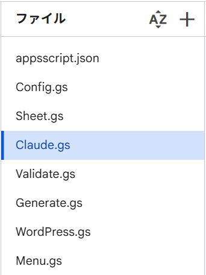
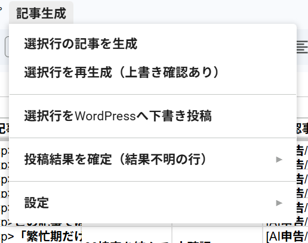
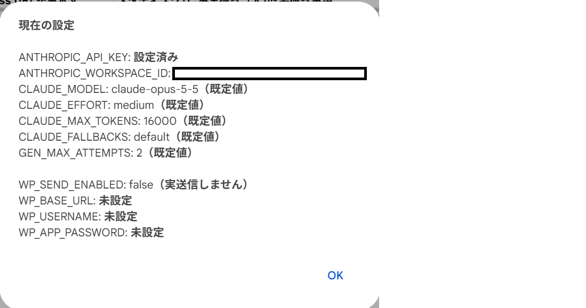
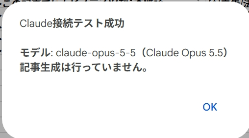
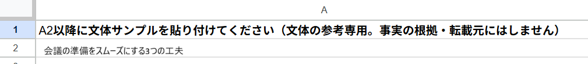

# 設定手順

> A〜Cは2026-11-06〜11-11に実機で実施しました。Dは今回の範囲外のため未実施です。画面の名称は変わっている場合があります。

作業は上から順に、1手順ずつ進めてください。

## A. スプレッドシートとコード

1. 新しいGoogleスプレッドシートを作成します。
2. メニューの **拡張機能 > Apps Script** を開きます。
3. **プロジェクトの設定**（歯車）で「`appsscript.json` マニフェスト ファイルをエディタで表示する」をオンにします。
4. **エディタ**に戻り、`appsscript.json` の中身を `src/appsscript.json` で置き換えます。
5. 既存の `コード.gs` を削除し、次の7ファイルを同じ名前で作成して中身を貼り付けます。
   `Config` / `Sheet` / `Claude` / `Validate` / `Generate` / `WordPress` / `Menu`

   

6. 保存して、スプレッドシートを再読み込みします。メニューに **記事生成** が表示されます。

   

7. **記事生成 > 設定 > シートを準備** を実行します。初回は権限の承認を求められます。
   `記事管理` と `文体サンプル` の2シートが作られます。

## B. Claude APIキー

8. [Claude Console](https://platform.claude.com/) でAPIキーを発行します。
9. Consoleで利用上限（spend limit）を設定します。テスト中は低めをお勧めします。
10. Apps Scriptの **プロジェクトの設定 > スクリプト プロパティ** に次を追加します。

| プロパティ | 値 |
|---|---|
| `ANTHROPIC_API_KEY` | 発行したキー |

キーをコード、シート、チャット、メールに貼らないでください。
この画面はキーの値がそのまま表示されるため、スクリーンショットを撮らないでください。

キーがワークスペースに紐づかない種類の場合は、`ANTHROPIC_WORKSPACE_ID` も必須です（下の「任意の設定」の表）。設定しないと、接続テストが400エラーになります。

11. **記事生成 > 設定 > 設定を確認（通信なし）** で `設定済み` と表示されることを確認します。キーの値は表示されません。

    

12. **記事生成 > 設定 > Claude接続テスト** を実行します。モデル情報の取得だけを行い、記事は生成しません。

    

### 任意の設定

| プロパティ | 既定値 | 説明 |
|---|---|---|
| `ANTHROPIC_WORKSPACE_ID` | なし | ワークスペースに紐づかないキーで必須。`wrkspc_` で始まるID（Console の Settings > Workspaces の ID 列） |
| `CLAUDE_MODEL` | `claude-opus-5-5` | 使用モデル |
| `CLAUDE_EFFORT` | `medium` | `low` / `medium` / `high` / `xhigh` / `max` |
| `CLAUDE_MAX_TOKENS` | `16000` | 出力の上限 |
| `CLAUDE_FALLBACKS` | `default` | `off` で拒否時のフォールバックを無効化 |
| `GEN_MAX_ATTEMPTS` | `2` | 検証違反時の作り直しを含む回数（上限3） |

## C. 文体サンプル

13. `文体サンプル` シートのA2以降に、支給サンプルを貼り付けます。合計20,000字までです。
    複数行の文章をA2に貼ると、改行ごとに下のセルへ分かれます。A2以降はまとめて読み込むので、そのままで問題ありません。A1の案内文は消さないでください。

    

サンプルは文体の参考にのみ使い、事実の根拠や転載元にはしません。

## D. WordPress連携（実送信は最後に）

ここまでの設定では実送信されません。`WP_SEND_ENABLED` が `true` でなければ、投稿メニューは送信内容の確認だけを行います。

**今回の範囲ではこの章の手順は行いません。** `WP_SEND_ENABLED` を設定しないまま、投稿メニューで送信内容を確認するところまでです。

14. WordPress管理画面の **ユーザー > プロフィール** で、アプリケーションパスワードを発行します。
    投稿権限のあるユーザー（投稿者や編集者）を使い、管理者アカウントは避けてください。
15. スクリプトプロパティに次を追加します。

| プロパティ | 値 |
|---|---|
| `WP_BASE_URL` | `https://` で始まるサイトのURL（例：`https://example.com`） |
| `WP_USERNAME` | ユーザー名 |
| `WP_APP_PASSWORD` | アプリケーションパスワード |

16. **記事生成 > 設定 > WordPress接続テスト** を実行します。認証の確認だけで、投稿はしません。
17. テスト用サイトで確認できる段階になってから、次を追加します。

| プロパティ | 値 |
|---|---|
| `WP_SEND_ENABLED` | `true`（完全一致。これ以外はすべて実送信なし） |

実送信を止めるときは、この値を削除するか `false` にします。
