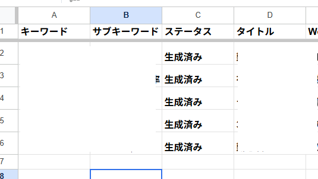
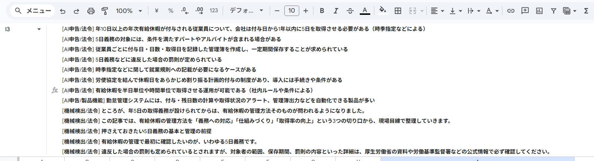
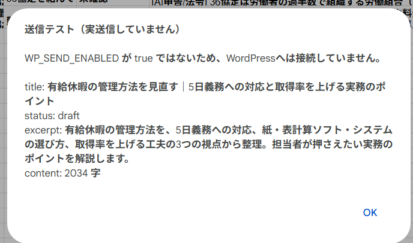
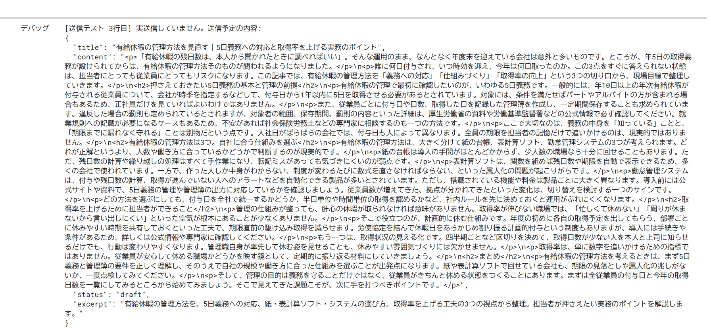

# 使い方

## 記事を生成する

1. `記事管理` シートのA列にキーワード、B列にサブキーワード（任意）を入力します。
2. その行のセルを1つ選択します。複数行を選ぶと実行されません。
3. **記事生成 > 選択行の記事を生成** を実行します。数分かかる場合があります。
4. 完了すると、D列（タイトル）、F列（本文HTML）、G列（説明文）が入り、C列が `生成済み` になります。
   完了画面には本文の文字数、説明文の文字数、試行回数が出ます。**この数字はシートに残らない**ので、記録が必要なら閉じる前に控えてください。

   

## 事実を確認する

生成された記事は下書きです。**AIの生成だけでは事実確認済みになりません。**

1. I列の `要確認事項` を確認します。

   

   - `[AI申告]`：AIが確認が必要と申告した記述
   - `[機械検出]`：法令、料金、数値、日付、機能などの語句を含む文
2. 検出されていない記述も含めて、公式情報で確認します。
3. 必要ならD、F、G列を編集します。
4. 確認が終わったら、H列を `確認済み` にします。直す点が残るなら `要修正` にします。

スクリプトがH列を `確認済み` にすることはありません。

## WordPressへ下書き投稿する

1. `生成済み` の行を1行選択します。
2. **記事生成 > 選択行をWordPressへ下書き投稿** を実行します。

| 設定 | 動作 |
|---|---|
| `WP_SEND_ENABLED` が `true` 以外（初期状態） | 送信内容を表示するだけで、通信しません。ステータスも変わりません |
| `WP_SEND_ENABLED` が `true` | 確認ダイアログの後、下書きとして送信します |

送信するのは `title`（D列）、`content`（F列）、`status: draft`、`excerpt`（G列）の4項目です。
実送信しない設定のときは、この4項目の中身が Apps Script の **実行数 > `menuPost`** のログに出ます。

### 実送信せずに送信内容を確かめる

1. **記事生成 > 設定 > 設定を確認（通信なし）** で、`WP_SEND_ENABLED: false（実送信しません）` を確かめます。
2. `生成済み` の行を1行選び、**記事生成 > 選択行をWordPressへ下書き投稿** を実行します。
3. 画面の見出しが **「送信テスト（実送信していません）」** なら、WordPressへは接続していません。先に「投稿の確認」が出た場合は実送信がオンです。**キャンセル** を押してください。

   

4. Apps Scriptの左端の **実行数** を開き、一番上の `menuPost` を開きます。`[送信テスト ○行目]` のログに、`title`、`content`、`status`、`excerpt` の4項目が出ます。

   

5. 実行後も、その行のC列が `生成済み`、E列が空のままであることを確かめます。
公開はWordPress管理画面で人が行います。E列のURLは下書きのため、ログインしないと表示できない場合があります。

## 失敗したとき

C列、K列（失敗工程）、L列（エラー内容）を確認します。生成と投稿は別々に再実行できます。

| ステータス | 意味 | 次の操作 |
|---|---|---|
| `生成失敗` | 記事は保存されていません | 原因を解消して **選択行の記事を生成** |
| `投稿失敗` | 下書きは作成されていません | 原因を解消して、もう一度投稿 |
| `投稿結果不明` | 作成された可能性があります | 下記の手順で確定 |
| `生成中` / `投稿中` が続く | 処理が中断した可能性があります | 7分以上経ってからメニューを再実行 |

`投稿中` のまま中断した行を再実行しても送信はされず、`投稿結果不明` に変わります。

### 投稿結果不明を確定する

自動では再投稿しません。

1. WordPress管理画面の下書き一覧を確認します。**記事生成 > 投稿結果を確定 > 同じタイトルの下書きを検索** も使えます。
2. 結果に応じて操作します。
   - 作成されていた：**投稿されていた（IDを入力）** で投稿IDを入力します。
   - 作成されていなかった：**投稿されていなかった（再投稿を許可）** を実行してから、もう一度投稿します。

## 記事を作り直す

**記事生成 > 選択行を再生成（上書き確認あり）** を実行します。人が編集した内容も上書きされます。失敗した場合は以前の記事が残ります。

投稿IDやURLが記録された行は再生成できません。WordPressの下書きとずれるのを防ぐためです。新しい行で作成してください。

## 守っていただくこと

- A〜N列の順番と見出しを変更しないでください。変更すると処理を止めます。
- C、J、K、L列を手で書き換えないでください。二重投稿の防止が効かなくなる場合があります。
- 一度に処理できるのは1行だけです。別の処理の実行中は開始できません。
